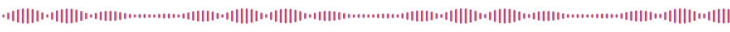
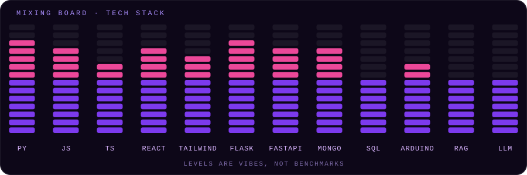

 

## 🎧 Liner Notes

> *Every great track has a story behind the sound. Here's mine.*

I build whole products end to end: **APIs, databases, React interfaces, and even the hardware that talks to them.** I think in systems the way a producer thinks in layers: a solid backend is the bassline, a clean UI is the melody, and ML is the part that makes people ask *"wait, how did it know that?"*

|  | 🎚️ Channel | Details |
|---|---|---|
| 🎓 | **Studio** | B.Tech Information Technology, St Francis Institute of Technology (Expected 2027) |
| 🔭 | **Exploring** | Agentic AI · Retrieval Augmented Generation (RAG) · LLM orchestration |
| 🎯 | **Current goal** | A full-stack / backend developer role or internship |
| 🗣️ | **Languages** | English · Hindi · Marathi |
| 🎵 | **Off-duty** | Audio and sound, over on [@joels_audio](https://www.instagram.com/joels_audio/) |

## 💿 The Tracklist

*Six tracks, six different sounds.*

| # | Track | The Vibe | Stack | Status |
|:-:|---|---|---|:-:|
| **01** | 🧹 **[Nukelear](https://github.com/joel-patole/Nukelear)** | Developer toolkit that scans nested workspaces and wipes heavy folders (`node_modules`, `venv`, build artifacts), plus browser upload to GitHub with secret detection and credential redaction. | `HTML` `TypeScript` `JavaScript` `Shell` | 🟡 Recording |
| **02** | 🚦 **[SafeNav_Mumbai](https://github.com/joel-patole/SafeNav_Mumbai)** | Mumbai accident-hotspot system: FastAPI + MongoDB backend, ML risk prediction and an interactive Leaflet map. | `FastAPI` `MongoDB` `ML` `Leaflet` | ✅ Released |
| **03** | 📡 **[RFID-based-attendance-server](https://github.com/joel-patole/RFID-based-attendance-server)** | ESP8266 + MFRC522 reads cards and sends scans over Wi-Fi to a Flask server with a live Socket.IO dashboard. | `ESP8266` `Flask` `Socket.IO` | ✅ Released |
| **04** | 🎬 **[lumiere](https://github.com/joel-patole/lumiere)** | A React + Vite front-end build. | `React` `Vite` `CSS` | 🟡 Recording |
| **05** | 🔐 **DocuVault** | Secure document manager with full CRUD and Clerk auth, where users only see their own files. | `Flask` `MongoDB` `Clerk` | ✅ Released |
| **06** | 🏙️ **UrbanLens AI** | Agentic AI platform that tells you if a city suits you, using an orchestrator, specialist agents, RAG and live APIs. | `Agentic AI` `RAG` | 🟡 Recording |

## 🎛️ The Mixing Board

<b>🎹 Open the full rack (every tool in the studio)</b>

 

| Slot | Items |
|---|---|
| ⚔️ **Languages** | Python · JavaScript · TypeScript · SQL (basic) · Shell · HTML · CSS |
| 🛡️ **Frontend** | React.js · Tailwind CSS · Leaflet.js · responsive UI |
| 🔮 **Backend** | Flask · FastAPI · REST API design · Auth (Clerk) · CRUD systems |
| 🗄️ **Databases** | MongoDB · SQL (basic) |
| 🧠 **AI / ML** | ML for risk prediction · LLMs · RAG · Agentic AI · Orchestration |
| 📡 **IoT** | ESP8266 · Arduino IDE · MFRC522 RFID · Wi-Fi communication |

## 📈 Chart Position

## 📨 Request a Track

Got a project that needs a backend and a brain, an API to design, or a gadget that needs to talk to the internet? Let's make something.

  

*🎶 Thanks for stopping by. Leave the volume up. 🎶*

